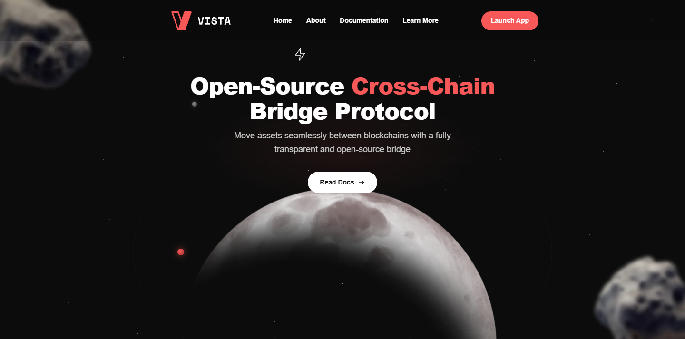
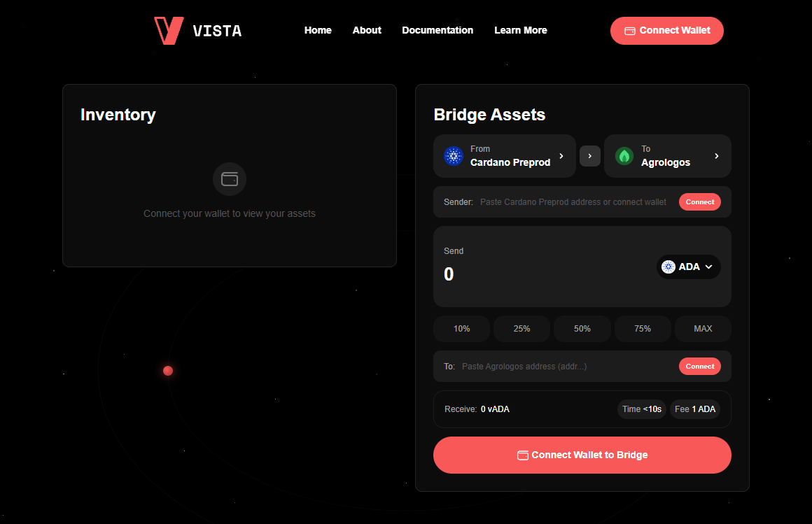
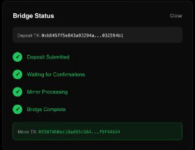

# Vista Bridge

Vista Bridge is Agrow Labs’ open-source software for transferring assets between Cardano and other configured blockchain networks. In the web app, you choose a route and use your wallet to send a deposit. A bridge worker detects the deposit on the source network and submits a matching transaction on the destination network.



The repository includes routes for moving test ADA between Cardano Preprod and Preview. In the Ethereum example, a deposit of test ETH on Sepolia mints wrapped ETH (`vETH`) on Cardano Preprod. Sending `vETH` back releases ETH on Sepolia. Each direction is configured as its own route. [Cardano testnet guide](bridge/README.md) · [Ethereum–Cardano testnet guide](bridge/docs/ethereum-bridge.md)

## The bridge interface

The bridge form at `/app` shows the source network, destination network, asset, and amount. Connecting a wallet populates the inventory on the left.



After you submit a deposit, the status panel tracks confirmations and the destination transaction. The panel below shows the completed transfer from the repository’s testnet demo. You can revisit transfers from the same browser at `/app/history`. [Watch the Ethereum-to-Cardano demo](bridge/recordings/eth-to-cardano-bridge.mp4)



## Bridge components

| Component | Role in a transfer | Source |
| --- | --- | --- |
| Web app | Connects to a browser wallet, prepares the deposit, and displays transfer status. | [Next.js frontend](bridge/frontend/) |
| HTTP API | Lists configured routes, accepts deposit registrations, and returns status by transaction hash. | [Elysia API](bridge/offchain/src/api/) · [shared API types](bridge/packages/shared/) |
| Route worker | Starts a source indexer and a destination mirror for each configured direction. | [Worker entry point](bridge/offchain/src/main.ts) · [chain selection](bridge/offchain/src/common/chain-factory.ts) |
| Source indexer | Watches a deposit address on the source network and passes detected deposits to the relayer. | [Cardano indexer](bridge/offchain/src/cardano-indexer/) · [EVM indexer](bridge/offchain/src/evm-indexer/) |
| Relayer | Queues deposits for the mirror and records pending and processed transfers in SQLite. | [Relayer](bridge/offchain/src/relayer/) · [database](bridge/offchain/src/common/database.ts) |
| Destination mirror | Builds, signs, and submits the destination transaction, then reports its status. | [Cardano mirror](bridge/offchain/src/cardano-mirror/) · [EVM mirror](bridge/offchain/src/evm-mirror/) |

For frontend development, run the integrated worker in `bridge/offchain/`. The top-level `bridge-offchain/` directory contains a standalone Cardano worker with its own indexer, relayer, mirror, and npm lockfile.

## What's in this repository

Agrow Labs brought six Vista Foundation repositories together here. The revision column identifies the original source for each directory.

| Directory | Contents | Imported revision |
| --- | --- | --- |
| [bridge/](bridge/) | Integrated application, workers, [engineering guides](bridge/docs/), and demo recording | [`c43c533`](https://github.com/vista-foundation/bridge/commit/c43c533fe3cd37f334ec242f11b11913b501d29d) (`main`) |
| [smart-contracts/](smart-contracts/) | Reusable Aiken contracts for [custodial transfers](smart-contracts/custodial-transfer/), [escrow services](smart-contracts/escrow-services/), and [permissioned minting](smart-contracts/minting/permissioned-mint/), with demos | [`e5d16a4`](https://github.com/vista-foundation/smart-contracts/commit/e5d16a46b5676220777996716c4f4e9540249a13) (`main`) |
| [bridge-offchain/](bridge-offchain/) | Standalone Cardano worker | [`fd38e50`](https://github.com/vista-foundation/bridge-offchain/commit/fd38e501393db8f2e02821d4c6c75926dc69740b) (`master`) |
| [design-docs/](design-docs/) | [Protocol design](design-docs/VISTA-Protocol/Design-and-Architecture.md), diagrams, and generation tools | [`8149136`](https://github.com/vista-foundation/design-docs/commit/8149136be0960b42d7260b7455e98677842d638b) (`main`) |
| [documentation/](documentation/) | Foundation documentation README and license | [`d287b89`](https://github.com/vista-foundation/documentation/commit/d287b894d4f0b9269882610510ccfa4f484131aa) (`main`) |
| [.github/](.github/) | Foundation’s [GitHub organization profile](.github/profile/README.md) | [`14b763a`](https://github.com/vista-foundation/.github/commit/14b763a7c4c154eeaaaffc624591a807bb5eee11) (`main`) |

## Run the bridge locally

From the monorepo root, install the integrated workspace using Bun 1.3 or later.

```sh
cd bridge
bun install
```

Copy [the environment template](bridge/offchain/config/env.template) to `bridge/offchain/.env`. Set the source and destination provider credentials, deposit addresses, and signing wallet for your testnet route. Use the [route configuration guide](bridge/docs/route-configuration.md) for multiple routes or the [Ethereum bridge guide](bridge/docs/ethereum-bridge.md) for EVM settings.

Open two terminals at the monorepo root.

| Terminal | Working directory | Command |
| --- | --- | --- |
| API and workers | `bridge/offchain` | `bun run dev` |
| Frontend | `bridge/frontend` | `bun run dev` |

Open the [local bridge app](http://localhost:3000/app). The API exposes [health](http://localhost:3001/api/health) and [configured routes](http://localhost:3001/api/routes). Set `NEXT_PUBLIC_BRIDGE_API_URL` in the frontend environment if the API runs at another address.

## Development checks

| Working directory | Command | What it checks |
| --- | --- | --- |
| `bridge/frontend` | `bun run test --run` | Frontend unit tests |
| `bridge/offchain` | `bun run test:unit --run` | Worker unit tests under Vitest |
| `bridge/offchain` | `bun run test:api` | HTTP API tests under Bun |
| A contract directory containing `aiken.toml` | `aiken check` | That validator’s Aiken checks and tests |

Use the compiler version in each contract’s manifest. The [custodial transfer](smart-contracts/custodial-transfer/) and [escrow services](smart-contracts/escrow-services/) contracts target Plutus V3. The [permissioned minting policy](smart-contracts/minting/permissioned-mint/) targets Plutus V2. The wallet phrases bundled in the contract demos are public test fixtures. Use fresh wallets for funded environments.

## Import history

The original commits retain their IDs and authors. Tags named `import/<repository>/<branch>` mark every source branch tip at import time. The organization profile uses the tag prefix `import/org-profile/`. To inspect earlier changes to a component, use its original path inside the tagged source tree.

```sh
git tag --list 'import/*'
git log import/bridge/main -- frontend/
```

## License

Agrow Labs publishes Vista Bridge under **Creative Commons Attribution 4.0 International (CC BY 4.0)**, except where a component or file includes its own terms. When reusing material under CC BY 4.0, credit the creators, link to the license, and indicate any changes. [License summary](https://creativecommons.org/licenses/by/4.0/) · [Full license](LICENSE)

The imported [smart contracts](smart-contracts/LICENSE), [design documents](design-docs/LICENSE), and [documentation](documentation/LICENSE) carry Apache 2.0 license files. The [integrated bridge README](bridge/README.md#license) identifies CC BY-SA 4.0. Both workers include CC BY 4.0 license text, while their imported package manifests identify CC BY-SA 4.0. See the [integrated worker](bridge/offchain/) and [standalone worker](bridge-offchain/) for those notices.

## Audit status

**Vista Bridge has not been audited as an integrated system.**
